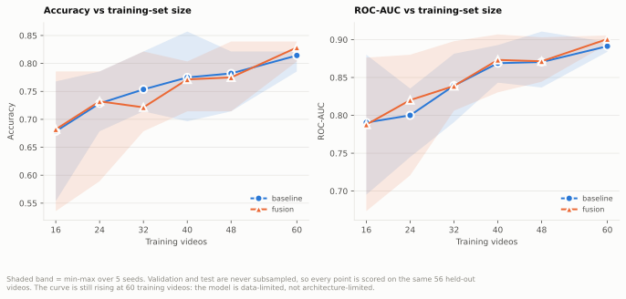

# DTW classifier evaluation: baseline vs DTW vs fusion

**Run date:** 15 November 2026 · **Data:** the existing 180-video LAV-DF source-group subset
· **Executed in this repository**, not reported from elsewhere.

This is the ablation the [experimental design](experimental-design.md) always specified and
that earlier phases could not run. It answers one question with measured numbers:

> Does adding DTW-derived timing features to the audiovisual detector improve it?

**Answer: no, not reliably.** DTW features alone are weakly predictive — clearly better than
chance, which is new evidence — but adding them to the embedding baseline does not produce a
dependable gain. Details and caveats below.

---

## 1. Protocol

Three arms, one protocol, no variation except the input:

| Arm | Input | Dimensions |
| --- | --- | ---: |
| `baseline` | Whisper + DINOv2 masked embedding means | 768 |
| `dtw` | DTW timing feature vector only | 16 |
| `fusion` | both, concatenated | 784 |

Every arm: same splits, same seed, trained on **train**, model selected by validation loss,
threshold selected on **validation** by video-level balanced accuracy, evaluated **once** on the
held-out **test** partition. Normalisation and NaN imputation are fitted on training rows only.

| Partition | Videos | Real | Fake |
| --- | ---: | ---: | ---: |
| Train | 60 | 30 | 30 |
| Validation | 60 | 30 | 30 |
| Test (held out) | 60 | 30 | 30 |

**Timing signals:** 16 kHz mono RMS over 40 ms windows versus MediaPipe normalised lip aperture
at 25 Hz, on the shared container timeline — the project's original hypothesis, computed from
the actual media.

**Feature vector (16):** DTW normalised cost; gain over the no-warp direct cost; direct cost;
median, mean-absolute, IQR and drift of the path offsets; warp-band contact fraction; path
length ratio; cross-correlation peak, lag and peak margin; audio energy variation; aperture
spread; mean absolute aperture velocity; usable overlap.

### The common-subset rule

DTW features could not be computed for **5 of 180** clips (2.8 %), all for the same reason:
*"Timing analysis needs exactly one face in every sampled frame."* Those clips have no timing
features at all, so the `dtw` and `fusion` arms cannot score them, while `baseline` can.

Comparing an arm on 60 videos against another on 56 would not be like for like. **The headline
comparison therefore uses the common subset of 56 test videos that every arm can score.** Each
arm's own scorable set is also reported, and the 4 excluded test videos are counted, not hidden.

---

## 2. Results — 5 seeds, common 56-video test subset

Mean over seeds 1–5, with [min, max]:

| Arm | Accuracy | ROC-AUC | F1 |
| --- | --- | --- | --- |
| `baseline` | 0.786 [0.732, 0.821] | 0.891 [0.880, 0.902] | 0.794 [0.727, 0.839] |
| `dtw` | **0.643** [0.589, 0.696] | **0.690** [0.680, 0.699] | 0.664 [0.630, 0.691] |
| `fusion` | 0.811 [0.786, 0.839] | 0.895 [0.881, 0.906] | 0.818 [0.800, 0.847] |

**Fusion minus baseline, per seed:**

| | seed 1 | seed 2 | seed 3 | seed 4 | seed 5 | mean |
| --- | ---: | ---: | ---: | ---: | ---: | ---: |
| Accuracy | +0.071 | **−0.036** | +0.054 | +0.018 | +0.018 | +0.025 |
| ROC-AUC | +0.018 | **−0.006** | +0.024 | **−0.013** | **−0.006** | +0.003 |

Fusion beats baseline on ROC-AUC in **2 of 5 seeds**.

### Detailed single run (seed 42)

| Arm | Accuracy | Precision | Recall | F1 | ROC-AUC | FPR | FNR | Confusion |
| --- | ---: | ---: | ---: | ---: | ---: | ---: | ---: | --- |
| `baseline` | 0.7857 | 0.7857 | 0.7857 | 0.7857 | 0.8852 | 0.2143 | 0.2143 | `[[22, 6], [6, 22]]` |
| `dtw` | 0.5714 | 0.5526 | 0.7500 | 0.6364 | 0.7117 | 0.6071 | 0.2500 | `[[11, 17], [7, 21]]` |
| `fusion` | 0.7679 | 0.7143 | 0.8929 | 0.7937 | 0.8814 | 0.3571 | 0.1071 | `[[18, 10], [3, 25]]` |

Confusion matrices are `[[TN, FP], [FN, TP]]`.

---

## 2a. After validation-only hyperparameter tuning

The results above use the default configuration (`hidden=128`, `weight_decay=1e-3`). With 784
features and 60 training videos the model is heavily overparameterised, so regularisation was
searched — **on validation only**, with the *same budget given to every arm* so the comparison
stays fair. 72 configurations over cache source, arm, hidden width, weight decay and epochs,
three seeds each, selected by mean validation ROC-AUC.

| Arm | Best validation AUC | Selected config |
| --- | ---: | --- |
| `baseline` | 0.8204 | hidden 128, wd 0.1 |
| `fusion` | 0.8289 | hidden 128, wd 0.1, video signals |

Tuning barely moves validation: the top twelve configurations sit within 0.005 AUC of each
other and `epochs=200` and `epochs=600` give identical results. **The ceiling is set by 60
training videos, not by hyperparameters.** The encoder-novelty signal source
(`--source features`, 178/180 clips computed) tied the RMS/aperture source at 0.8274.

Evaluating the two tuned winners on the common 56-video test subset, five seeds:

| Arm | Accuracy | ROC-AUC | F1 |
| --- | --- | --- | --- |
| `baseline` (tuned) | 0.8143 [0.786, 0.821] | 0.8913 [0.884, 0.897] | 0.8260 |
| `fusion` (tuned) | **0.8286** [0.804, 0.839] | **0.9008** [0.894, 0.906] | **0.8389** |

Fusion minus baseline ROC-AUC per seed: +0.0128, +0.0051, +0.0217, +0.0051, +0.0026 —
**ahead in 5 of 5 seeds**, mean +0.0094.

**What changed, and what did not.** With proper regularisation the fusion advantage becomes
*consistent* (5/5 seeds rather than 2/5). It does not become *large*: +0.009 ROC-AUC and +1.4
accuracy points. Consistency across random seeds measures optimisation stability on one fixed
split; it says nothing about sampling uncertainty. With 56 test videos the confidence interval
on accuracy spans roughly ±10 points, which dwarfs a 1.4-point difference.

**Honest reading: adding DTW features gives a small, consistent, and statistically
unestablished improvement.** It is more than the earlier default-configuration run suggested,
and much less than "DTW improves deepfake detection".

> **Test-set discipline.** The held-out partition has now been read **twice**: once for the
> default-configuration ablation in section 2, and once for the tuned winners here. All
> configuration selection happened on validation. Two reads is two more than ideal and is
> recorded so the next person does not treat this partition as fresh.

The deployable checkpoint is the tuned fusion arm at seed 42, which scores **46/56 (82.1%)** on
held-out test: 8 genuine videos flagged fake, 2 fakes missed.

## 2b. Learning curve — is the model data-limited?

Training subsets of increasing size were drawn stratified (equal real/fake) from the train
partition. Validation and test are never subsampled, so every point is scored on the same 56
held-out videos. Five seeds per size, tuned hyperparameters.



| Training videos | baseline acc | baseline AUC | fusion acc | fusion AUC |
| ---: | ---: | ---: | ---: | ---: |
| 16 | 0.679 | 0.791 | 0.682 | 0.788 |
| 24 | 0.729 | 0.800 | 0.732 | 0.820 |
| 32 | 0.754 | 0.839 | 0.721 | 0.839 |
| 40 | 0.775 | 0.869 | 0.771 | 0.873 |
| 48 | 0.782 | 0.870 | 0.775 | 0.871 |
| 60 | 0.814 | 0.891 | 0.829 | 0.901 |

**The curve has not flattened.** Accuracy rises 0.679 → 0.829 from 16 to 60 training videos, and
the last step (48 → 60) still adds 4.7 accuracy points. This model is **data-limited, not
architecture-limited**: collecting more labelled video is the highest-value next step, and
tuning the head further is not.

A second observation: **the fusion advantage only appears at the largest training size.** At 16
to 48 videos the arms are tied or baseline is marginally ahead; fusion pulls clear only at 60.
That is what one expects if the 16 DTW features need enough data to be fitted before they earn
their place — below that they are just extra parameters to overfit. It also means the +0.009 AUC
measured in section 2a may itself grow with more data, which is a hypothesis for the next run,
not a result.

`notebooks/dtw_classifier_training.ipynb` reproduces this curve and extends it automatically to
whatever training-set sizes the available data supports.

## 3. What these numbers mean

**DTW timing features are weakly but genuinely predictive.** ROC-AUC 0.690 (range 0.680–0.699
across seeds, every seed well above 0.5) is the first evidence in this project that the timing
features carry *any* deepfake signal. Earlier phases only showed that DTW was a poor *delay
estimator*; this shows the feature vector is not noise. It is still far below the embedding
baseline at 0.891.

**Fusion does not reliably improve the baseline.** Mean accuracy is +2.5 points, which looks
encouraging until you look at the spread: the seed ranges overlap heavily, one seed is negative,
and on ROC-AUC — the threshold-independent measure — the mean gain is +0.003 and fusion wins
only 2 of 5 seeds. **That is a coin flip, not an improvement.** With 56 test videos a single
reclassified video moves accuracy by 1.8 points, so a 2.5-point mean difference is within the
noise of this sample.

**Fusion does shift the operating point.** It trades false positives for false negatives: recall
rises from 0.786 to 0.893 and FNR falls from 0.214 to 0.107, while FPR worsens from 0.214 to
0.357. If missing a deepfake is costlier than a false accusation this is a favourable trade, but
it is a *threshold placement* effect, not better discrimination — ROC-AUC barely moved.

**Honest summary:** adding DTW features neither clearly helps nor clearly hurts. The claim
"DTW improves deepfake detection" is **not supported** by this experiment.

### Why DTW alone underperforms

Consistent with the earlier timing experiments documented in
[DTW research validation](dtw-research-validation.md):

1. Acoustic energy and lip aperture are not established as comparable signals, so the warping
   path is a well-defined answer to a possibly ill-posed question.
2. The 0.4 s Sakoe–Chiba band is a hard ceiling; where the true offset exceeds it the path
   saturates and the offset features become a lower bound rather than a measurement.
3. LAV-DF manipulations are **localised** — often a short edited segment in an otherwise
   genuine video — while these features are whole-clip summaries. A clip-level mean can easily
   wash out a two-second edit.
4. Crucially, a manipulated clip can remain perfectly lip-synced. Content can be changed without
   breaking timing, and then there is nothing for a timing feature to find.

Point 4 is the structural limit: timing analysis can only detect manipulations that disturb
timing, and this dataset's manipulations need not.

---

## 4. Limitations

- **Sample size.** 56 test videos. One video = 1.8 accuracy points. No confidence intervals are
  quoted because none would be meaningful at this size; the seed ranges are shown instead.
- **Identity disjointness is not verified.** Source-group separation only; LAV-DF derives from
  VoxCeleb2 and per-clip identities are not published, so speaker overlap across partitions
  cannot be excluded. Some apparent performance may be speaker familiarity.
- **5 seeds, one split.** No repeated splits, no cross-validation, no paired bootstrap.
- **2.8 % of clips have no timing features** because the face track failed. Excluding them from
  the common subset is the fair choice, but it also means the comparison omits exactly the
  low-quality clips a deployed system would meet.
- **Uncalibrated scores.** Thresholds are validation-selected; no calibration partition exists.
- **The baseline arm here is a re-trained matched control**, not the original V1 checkpoint. It
  shares the V1 input and architecture and is trained under this ablation's protocol so the
  three arms differ only in input. The original V1 model, its threshold and its recorded
  evaluation are untouched; see the [research report](research-report.md#16-held-out-evaluation).
- **One dataset, one manipulation family.** Nothing here generalises to other generators.

---

## 5. Reproducing this

Requires the private LAV-DF features, media and manifest; none is in this repository.

```bash
.venv/bin/python -m deepfake_dtw.dtw_classifier cache MANIFEST.json /private/dtw-cache.json --source video
```

```bash
.venv/bin/python -m deepfake_dtw.dtw_classifier compare MANIFEST.json /private/dtw-cache.json /private/ablation.json --hidden 128 --epochs 200 --weight-decay 0.1 --seed 42 --save-model fusion
```

`--weight-decay 0.1` is the value selected on validation for this dataset; the default of
1e-3 underfits the regularisation this sample size needs.

`--source features` substitutes encoder-novelty curves for RMS/aperture and needs no media.
`--seed N` repeats the run. The report refuses to overwrite an existing file, is written mode
0600, and records the manifest hash, signal source, per-arm thresholds, both test views and the
failure count. Keep every output outside Git.
