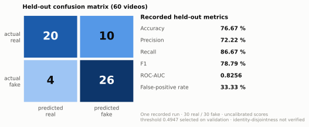
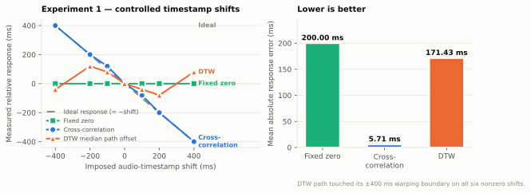
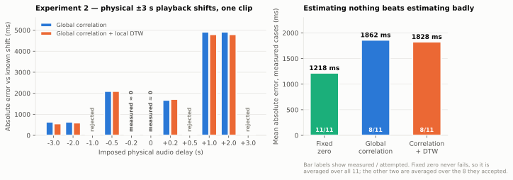

# Deepfake Detection for Identity Impersonation Using Dynamic Time Warping

**A research prototype and an honest negative result**

Status: final project report · 15 November 2026 · local research prototype, not a deployed system

---

## 1. Abstract

Audiovisual deepfakes that impersonate a specific identity must synthesise both a voice and a
face. A natural hypothesis is that synthesis leaves measurable **temporal inconsistencies**
between the speech signal and the visible motion of the mouth, and that explicitly modelling
those inconsistencies — for example with Dynamic Time Warping (DTW) — should help a detector.

This project built the machinery needed to test that hypothesis and then tested it. We trained
an audiovisual deepfake classifier on a 180-video subset of LAV-DF using frozen Whisper
`tiny.en` audio features and frozen DINOv2 ViT-S/14 mouth-region visual features with late
fusion. On a 60-video held-out partition it reached 76.67 % accuracy, 78.79 % F1 and 0.8256
ROC-AUC at a validation-selected threshold. Separately, we implemented band-constrained DTW
over a scalar acoustic-energy signal and a scalar lip-aperture signal, and evaluated its ability
to recover **known** timing perturbations under two controlled protocols: in-memory timestamp
shifts of ±400 ms, and physically re-encoded audio delays of ±3 s.

**DTW did not perform well.** Against controlled ±400 ms timestamp shifts, the DTW median path
offset had a mean absolute response error of 171.43 ms, while ordinary normalised
cross-correlation achieved 5.71 ms on the same signals; the DTW path saturated its warping
band on all six nonzero shifts. Against physical multi-second delays, a global correlation
search and a correlation-plus-local-DTW variant produced mean absolute errors of 1862.50 ms and
1827.50 ms respectively over the eight cases they accepted, while rejecting three outright —
both worse, on this measure, than the trivial baseline of always predicting zero offset
(1218.18 ms over all eleven cases).

We therefore report that **no DTW contribution to deepfake classification accuracy has been
demonstrated**, and we did not run a DTW-versus-no-DTW ablation, because the precondition for a
meaningful ablation — evidence that the two scalar signals are comparable and that the alignment
recovers known offsets — was not met. All measurements come from a single speaker and a single
recording whose natural lip-sync offset is unknown, so they bound what we can claim rather than
settling the underlying question. We analyse why the result is structurally unsurprising, and we
specify the protocol a credible follow-up would need.

---

## 2. Introduction

Synthetic media that convincingly impersonates a real person is now cheap to produce. The
threat that motivates this project is **identity impersonation**: a video in which a particular
individual appears to say something they never said. Because such a video must be coherent in
two modalities at once, the relationship *between* those modalities is an attractive place to
look for evidence of manipulation. A face whose mouth does not move quite in step with the
words is, intuitively, suspicious.

Dynamic Time Warping is the classical tool for comparing two time series that may run at
different rates. Introduced for spoken-word recognition by Sakoe and Chiba [1], it finds a
monotone correspondence between two sequences that minimises accumulated distance, subject to
constraints on how far the correspondence may deviate from the diagonal. If audio and lip motion
are two views of the same underlying speech process, DTW ought to be able to align them, and the
*cost* and *shape* of that alignment ought to carry information about whether the two views
really came from the same event.

This report documents what happened when that idea was implemented and measured. It is
deliberately organised so that the negative result is not buried: Sections 17–19 contain the
experiments and the comparison, Section 20 states what threatens the validity of even the
negative claim, and Section 22 says what would have to be done differently.

The project is a local research prototype. It distributes no model weights, no media and no
dataset, and it produces no calibrated probability or identity verification.

---

## 3. Problem statement

Given a short video containing one speaking face and its own audio track, decide whether the
video has been manipulated.

The specific research question is narrower, and is the one this project exists to answer:

> **Does explicitly modelling the temporal alignment between the speech signal and visible
> mouth movement — via constrained DTW — improve audiovisual deepfake detection, compared with
> an otherwise identical detector that does not model alignment?**

Answering that requires three things in order:

1. A working audiovisual detector to serve as the baseline (arm A).
2. Evidence that the timing signals being aligned are **comparable**, and that the alignment
   procedure recovers offsets that are actually present.
3. A controlled comparison between the baseline and a DTW-augmented variant (arm B).

Step 1 is complete. **Step 2 failed**, and so step 3 was not attempted. Reporting that honestly,
rather than proceeding to an ablation whose inputs are not validated, is the central
methodological decision of this project.

---

## 4. Research objectives

| # | Objective | Outcome |
| --- | --- | --- |
| O1 | Build a timestamp-accurate audiovisual preprocessing pipeline | **Achieved** |
| O2 | Extract audio and visual representations from authorised pretrained encoders | **Achieved** |
| O3 | Train and evaluate a baseline audiovisual deepfake classifier | **Achieved** (one recorded run) |
| O4 | Implement constrained DTW correctly and verify it on synthetic signals | **Achieved** |
| O5 | Validate that the chosen audio/visual scalar signals are comparable, and that DTW recovers known offsets | **Not achieved — negative result** |
| O6 | Compare detection with and without DTW features | **Not attempted**, because O5 failed |
| O7 | Deliver a reproducible local demonstration with explicit limitations | **Achieved** |

O5 is the hinge. The remainder of this report explains how it was tested and why it failed.

---

## 5. Literature review

**Dynamic Time Warping.** Sakoe and Chiba [1] formulated DP-based time normalisation for
spoken-word recognition, including the slope constraints and the band restriction (now usually
called the Sakoe–Chiba band) that bound how far an alignment may wander from the diagonal. Their
symmetric form is the one used here. The method assumes the two sequences are measurements of
*comparable* quantities; the band is a prior on how much temporal distortion is plausible.

**Speech representation.** Whisper [2] is an encoder–decoder speech model trained with
large-scale weak supervision. We use only its encoder, at the `tiny.en` scale, as a frozen
feature extractor. An important property for this project: Whisper pads input to a fixed
30-second window and the encoder uses global self-attention, so any individual output position
can depend on padded context. Its nominal 20 ms frame positions are therefore not clean local
observations, which is a caveat for any timing claim built on them.

**Visual representation.** DINOv2 [3] is a self-supervised vision transformer trained on a
curated image corpus, released with ViT backbones at several scales. We use ViT-S/14 as a frozen
per-frame encoder over mouth-region crops. DINOv2 is a general-purpose *image* encoder: it has
no motion modelling and no audiovisual pretraining, which is a material limitation for a task
about timing.

**Face geometry.** MediaPipe Face Mesh [4] predicts a 468-vertex face mesh from monocular video
in real time. We use its landmarks both to crop the mouth region for the visual encoder and to
derive the scalar lip-aperture signal used in the DTW experiments.

**Datasets.** LAV-DF [5] is a localized audio-visual deepfake dataset in which manipulations are
applied to specific segments, with per-video metadata recording whether audio, video or both
were modified, the manipulated intervals, the link to the original real video, and an official
split. LAV-DF is derived from VoxCeleb2 [6], a large audiovisual speaker-recognition corpus;
this derivation is the reason identity overlap must be treated as an open question rather than
an assumption.

**The reference work for this project's motivation** is AV-Lip-Sync+, recorded in project notes
under DOI 10.1109/THMS.2025.3618409 and arXiv 2311.02733 [7], which (per a secondary archive of
its abstract) uses AV-HuBERT features and a multiscale temporal convolutional network to exploit
multimodal inconsistency. **We were never able to retrieve this paper**: the publisher, arXiv and
Crossref were all blocked by the execution environment's network policy throughout the project.
Every statement we make about it is therefore secondary evidence from an archived abstract, we do
not reproduce it, we do not compare against its reported numbers, and nothing in this project
should be read as replicating or refuting it.

**AV-HuBERT was deliberately not used.** Its licence restricts use for commercial or production
purposes, for surveillance, and for biometric processing. Since identity-impersonation analysis
plausibly touches biometric processing, and institutional clearance was not obtained, the
project built an independent baseline instead. This is a substantive divergence from the
motivating work and is stated as such rather than glossed.

---

## 6. Existing approaches and the research gap

Broadly, audiovisual deepfake detection takes three routes:

1. **Single-modality artifact detection** — find generator fingerprints in pixels or in audio.
   Effective within a generator family, historically brittle across families and across
   re-encoding.
2. **Cross-modal semantic consistency** — ask whether the face and the voice are saying the same
   thing, typically with a jointly pretrained audiovisual speech representation. This is the
   family the motivating work belongs to.
3. **Explicit temporal alignment** — treat the question as one of *timing* rather than content,
   and measure how well the two streams can be put in correspondence. This is the family this
   project set out to probe with DTW.

The gap we intended to address is that route 3 is usually folded into route 2: alignment is
learned implicitly inside a joint representation rather than measured explicitly and reported
with units. An explicit alignment statistic would be interpretable, cheap, and independent of
any particular generator.

**What we found is a gap beneath the gap.** Route 3 presupposes two scalar time series that are
genuinely comparable. Without a jointly pretrained audiovisual encoder — which licensing
considerations put out of reach here — one must hand-pick signals, and the obvious hand-picked
pair (acoustic energy, mouth opening) turns out not to support the inference. The missing
ingredient is not a better warping algorithm; it is a validated correspondence between the two
signals being warped. Section 19 develops this argument from the measurements.

---

## 7. Proposed methodology

The design keeps two pathways strictly separate:

- **Prediction pathway.** Video → preprocessing → frozen Whisper + frozen DINOv2 → masked
  temporal means → late fusion → MLP head → uncalibrated score → threshold → label.
- **Experimental timing pathway.** Video → preprocessing → scalar audio RMS + scalar lip
  aperture on a shared timeline → constrained DTW and cross-correlation → descriptive timing
  statistics.

The timing pathway never feeds the prediction pathway. Every inference result carries
`dtw_used_for_prediction: false`. This separation was a precondition of the research design, not
an afterthought: it means the reported classifier metrics are unaffected by any timing work, and
that the timing work can be reported as negative without invalidating the baseline.

The intended final step — training arm B with DTW-derived features and comparing it to arm A
under identical conditions — was gated on the timing pathway first demonstrating that it could
recover known offsets. It did not, so arm B was never trained.

---

## 8. System architecture

```
 INPUT: one local MP4, <=30 s, <=100 MB, <=1920x1080, exactly 1 audio + 1 video stream
    |
    v
 [1] DECODE  (ffprobe + FFmpeg, protocol whitelist, bounded subprocess)
     - presentation timestamps = best_effort_timestamp x time_base  -> shared container timeline
     - audio -> 16 kHz mono f32          video -> frames @ 25 Hz grid, scaled 224x224
     - reject: non-increasing video PTS, discontinuous audio, out-of-bounds media
    |
    +--------------------------------+-------------------------------------+
    |                                                                      |
    v  PREDICTION PATHWAY                           EXPERIMENTAL TIMING PATHWAY  v
 [2] MediaPipe Face Mesh -> mouth crops           [5] audio RMS, 40 ms windows @ 25 Hz
     exactly 1 face/frame required                    lip aperture = |p13 - p14| / |p61 - p291|
     IoU continuity check                             on the SAME container timeline
    |                                                                      |
    v                                                                      v
 [3] FROZEN ENCODERS (hash-verified local checkpoints)              [6] z-normalise both
     Whisper tiny.en encoder  -> [1, 1500, 384]                         resample to 25 Hz grid
     DINOv2 ViT-S/14          -> [T, 384]                               |
    |                                                                   v
    v                                                           [7] constrained DTW
 [4] masked temporal mean per modality -> 384 + 384                   (Sakoe-Chiba band 0.4 s)
     training-set normalisation                                       + normalised cross-correlation
     late fusion -> concat 768 -> MLP -> logit                        |
    |                                                                 v
    v                                                           [8] descriptive statistics:
 [9] sigmoid -> UNCALIBRATED score                                    median path offset,
     compare to validation-selected threshold 0.4947                  normalised path cost,
     -> label "real" / "fake"                                         boundary-contact flag
    |                                                                 |
    +---------------------------> REPORTED SEPARATELY <---------------+
                                  (timing never enters the prediction)
```

Serving infrastructure — a loopback-only FastAPI job service and a React/TypeScript research
frontend — is described in [system architecture](system-architecture.md) and
[local research application](local-app-demonstration.md). It is engineering around the research
pipeline, not part of the scientific claim.

---

## 9. Dataset and preprocessing

**Dataset.** A 180-video subset of LAV-DF [5], selected under the provider's official split, in
*source-group* mode: each selected fake is matched to its exact `original` real video through
the provider's metadata, and source groups whose links cross official partitions are excluded
entirely.

| Partition | Videos | Composition |
| --- | ---: | --- |
| Train | 60 | balanced real/fake source pairs |
| Validation | 60 | balanced real/fake source pairs |
| Held-out test | 60 | 30 real, 30 fake |

LAV-DF labels are segment-level; a video is treated as `fake` when the provider's metadata sets
either `modify_audio` or `modify_video`. This is a transparent video-level aggregation, and it
means a "fake" video may be manipulated only in a short interval.

**What this subset is not.** It is not identity-disjoint. Source-group separation prevents a
real video and its own derived fake from landing in different partitions, but LAV-DF derives from
VoxCeleb2 [6] and participant identities are not published per clip, so the same person may
appear in more than one partition. Every result in this report is reported with
`identity_disjoint_verified: false`, and that caveat is not removable by any analysis we can do
on the data we hold.

**Preprocessing.** Media is decoded with ffprobe and FFmpeg under a protocol whitelist and hard
resource bounds. Presentation timestamps are computed as integer `best_effort_timestamp` values
multiplied by each stream's time base, so audio and video share one container timeline — this is
what makes any cross-modal timing statement well defined at all. Audio is downmixed to 16 kHz
mono; frames are selected on a 25 Hz timestamp grid and scaled to 224×224. Non-increasing video
timestamps and discontinuous audio are rejected rather than repaired.

MediaPipe Face Mesh [4] then produces mouth crops. Frames with zero faces are skipped; **more
than one face, or loss of tracking continuity under an IoU check, aborts extraction with an
explicit reason**. No crop is fabricated and no clip is silently partially processed.

Note that the stream-start quantity `audio_minus_video_seconds` reported by the decoder is an
**offset between stream starts, not a measured lip-sync delay**: AAC priming, padding and edit
lists all affect it.

---

## 10. Audio feature extraction

Two distinct audio representations are used, for two distinct purposes.

**For classification:** the frozen Whisper `tiny.en` encoder [2], loaded only from a local
checkpoint whose SHA-256 matches the official upstream digest
(`d3dd57…dd03`). Output is `[1, 1500, 384]` per clip.

The padding caveat matters and is stated wherever the features are used: Whisper pads to 30
seconds, so for a 12-second clip only about 601 of the 1500 nominal positions fall inside the
real audio, and because self-attention is global even those positions can depend on padded
context. Masked temporal means are taken over the valid region, but "valid" here means
"nominally within the input duration", not "provably uncontaminated".

**For the timing experiments:** a deliberately simple, interpretable scalar — root-mean-square
energy over 40 ms non-overlapping windows, timestamped at window centres, sampled at 25 Hz to
match the video grid:

$$
a_k \;=\; \sqrt{\frac{1}{W}\sum_{n=0}^{W-1} x^2\!\left[s_k + n\right]},
\qquad W = 640 \text{ samples (40 ms at 16 kHz)}
$$

with window start $s_k = k \cdot \lfloor 16000 / 25 \rfloor$ and timestamp
$t^a_k = t^a_0 + (s_k + W/2)/16000$.

RMS energy was chosen because it is transparent and because it is plausibly related to mouth
opening: louder speech often means a more open mouth. **That plausibility is the assumption this
project ended up testing, and it is the assumption that did not hold** (Section 19).

---

## 11. Visual feature extraction

**For classification:** the frozen DINOv2 ViT-S/14 backbone [3], loaded from a hash-verified
local checkpoint through a pinned, clean official source checkout (commit
`7764ea0f…25fc8`; a dirty or differently pinned checkout is refused). Mouth crops are encoded
per frame, giving `[T, 384]`.

DINOv2 is an image encoder. It has no temporal modelling and no audiovisual pretraining; any
timing information in the classifier comes from the sequence of per-frame embeddings and the
masked mean over them, not from the encoder.

**For the timing experiments:** a scalar lip aperture derived from Face Mesh landmarks —
inner-lip vertical opening normalised by mouth width, which makes it approximately invariant to
scale:

$$
v_k \;=\; \frac{\lVert \mathbf{p}_{13} - \mathbf{p}_{14} \rVert_2}
                {\lVert \mathbf{p}_{61} - \mathbf{p}_{291} \rVert_2}
$$

sampled at the video frame timestamps $t^v_k$. Landmarks 13/14 are the inner upper and lower
lip; 61/291 are the mouth corners. Frames where mouth width is degenerate, or where face count
is not exactly one, abort the computation.

An exploratory alternative representation, the time derivative $\dot v_k$ (aperture velocity,
by `numpy.gradient` against the video timestamps), was also evaluated. It is a candidate for
study, not a validated measure of speech-related motion.

---

## 12. Dynamic Time Warping: mathematical formulation

Let the two signals, after interpolation onto a common uniform grid
$g_i = g_0 + i/r$ (rate $r = 25$ Hz) over the overlapping support of both streams, be

$$
\hat{a} = \frac{a - \mu_a}{\sigma_a}, \qquad
\hat{v} = \frac{v - \mu_v}{\sigma_v}, \qquad i,j \in \{1,\dots,N\}
$$

where each signal is z-normalised independently so that the alignment compares *shape* rather
than units (RMS energy and a dimensionless aperture ratio have no common scale). Signals with
$\sigma < 10^{-8}$ are rejected rather than normalised.

The local cost is absolute difference:

$$
c(i,j) \;=\; \bigl|\, \hat{a}_i - \hat{v}_j \,\bigr| \;\ge\; 0
$$

The accumulated cost matrix $D$ is filled by dynamic programming with the symmetric step
pattern of Sakoe and Chiba [1]:

$$
D(i,j) \;=\; c(i,j) \;+\; \min
\begin{cases}
D(i-1, j-1) & \text{(diagonal: advance both)}\\
D(i-1, j)   & \text{(advance audio)}\\
D(i,\, j-1) & \text{(advance video)}
\end{cases}
$$

with boundary conditions $D(0,0) = 0$ and $D(i,0) = D(0,j) = \infty$ for $i,j > 0$.
Ties are broken in the fixed order diagonal → advance audio → advance video, which makes the
path deterministic.

A **warping path** $P = \bigl((i_1,j_1), \dots, (i_K,j_K)\bigr)$ is the minimising sequence
recovered by backtracking, and satisfies:

- *Boundary:* $(i_1,j_1) = (1,1)$ and $(i_K,j_K) = (N,N)$ — **both endpoints are required**.
- *Monotonicity and step size:* $i_{k+1}-i_k \in \{0,1\}$, $j_{k+1}-j_k \in \{0,1\}$, not both 0.
- *Band (Sakoe–Chiba):* $|i-j| \le B$, with $B = \lfloor w \cdot r \rfloor$ and
  $w = 0.4$ s, giving $B = 10$ grid steps.

From the path we take two statistics:

$$
\delta_k \;=\; g_{j_k} - g_{i_k}
\quad\text{(signed offset, positive = video later than audio)}
$$

$$
\widetilde{\delta} \;=\; \operatorname{median}_k\,\delta_k ,
\qquad
\bar{D} \;=\; \frac{D(N,N)}{K} \quad\text{(path-length normalised cost)}
$$

$\widetilde{\delta}$ is the quantity evaluated as a delay estimate in Sections 17–18.
$\bar{D}$ is a descriptive dissimilarity. **Neither is a probability of manipulation**, and a
low $\bar{D}$ is not evidence of authenticity.

For comparison we also compute normalised cross-correlation over candidate lags
$\tau \in [-L, L]$ sampled at $1/r$:

$$
\rho(\tau) \;=\;
\frac{\bigl\langle\, \hat{a}(g) - \overline{\hat{a}},\;\; \hat{v}(g+\tau) - \overline{\hat{v}(g+\tau)} \,\bigr\rangle}
     {\bigl\lVert \hat{a}(g) - \overline{\hat{a}} \bigr\rVert_2 \;\;
      \bigl\lVert \hat{v}(g+\tau) - \overline{\hat{v}(g+\tau)} \bigr\rVert_2},
\qquad
\hat{\tau} = \arg\max_{\tau} \rho(\tau)
$$

evaluated only on support where **both** signals exist at every candidate lag — no zero-padding
and no circular wraparound, since either would bias the peak. Ties prefer the smaller $|\tau|$.

---

## 13. Constrained alignment methodology

Three design choices deserve explicit justification, because two of them turn out to shape the
negative result.

**Why a band at all.** An unconstrained warping path can map a long stretch of one signal onto a
single point of the other, producing a low cost that reflects degenerate alignment rather than
genuine correspondence. The Sakoe–Chiba band bounds the distortion. It encodes a prior: *real
lip-sync error is small*.

**Why $w = 0.4$ s.** Perceptible lip-sync error in broadcast is on the order of tens of
milliseconds; 400 ms is generous for natural desynchronisation while still preventing degenerate
paths. **This choice is also a hard ceiling on what the statistic can express**, and Section 18
shows exactly what that costs when the true offset is seconds rather than milliseconds.

**Why both endpoints are required.** Forcing $(1,1) \to (N,N)$ keeps the path a complete
correspondence. But it also means a constant global lag cannot be represented cleanly: the path
must start and end matched, so a uniform shift gets absorbed into the interior of the path and
distorts $\widetilde{\delta}$. This is a known tension between "alignment" and "delay
estimation", and it is the second structural reason the median path offset underperforms a
plain lag search.

To separate those two concerns, a second experimental estimator (Section 18) first searches a
global lag over ±3 s by cross-correlation, then applies the ±0.4 s DTW **to a copy of the
timestamps with the global lag removed**, so that DTW is asked only to model residual local
distortion. Quality gates reject weak correlation peaks ($\rho < 0.15$) and ambiguous ones (a
competing peak within 0.02 at least 0.4 s away). Those thresholds are uncalibrated engineering
heuristics, and passing them does not establish that the modalities correspond.

**Software verification.** The implementation is covered by synthetic tests over identical
signals, pure shifts, time-stretching and compression, omitted and repeated events, additive
noise, boundary conditions, discontinuities and silence. These tests confirm that the path
satisfies the boundary, monotonicity, step and band constraints, that the cost is finite, and
that repeated runs are bit-for-bit identical. **They verify software properties, not recognition
accuracy.**

---

## 14. Experimental setup

| Component | Value |
| --- | --- |
| Platform | Linux x86-64, CPU |
| Python | 3.12 |
| PyTorch / torchvision | 2.5.1 / 0.20.1 |
| NumPy / SciPy | 1.26.4 / 1.15.3 |
| MediaPipe | 0.10.21 |
| Whisper | 20250625 at pinned commit `86098128…4227` |
| DINOv2 source | pinned commit `7764ea0f…25fc8` |
| Classifier training | Colab, CUDA (T4) |
| Timing experiments | CPU, 2 threads |

Training ran in Colab on GPU; all timing experiments and the application verification ran on
CPU. Experiment reports record the input video's SHA-256, the SHA-256 of each participating
source file, package versions, wall-clock time and peak process RSS (Linux process high-water
mark, excluding FFmpeg children).

**Media used for the timing experiments** is a single consented 12-second talking-face clip,
recorded by a consenting adult for this project and stored outside the repository. It is **not**
part of LAV-DF and not part of any evaluation partition. It is one speaker, one recording, one
acoustic environment.

**Separation of concerns.** The timing experiment CLIs require an explicit
`--consented-non-test` flag, refuse to overwrite their reports, write them mode 0600, and never
load the classifier or read a test partition. The corpus auditor rejects any manifest row marked
`test` *before opening any file*. These are guardrails against the most dangerous failure mode in
a project like this — quietly tuning against the held-out set.

---

## 15. Baseline classifier training

Frozen features; only the fusion head is trained.

| Setting | Value |
| --- | --- |
| Audio branch | Whisper `tiny.en` encoder, frozen → masked temporal mean → 384-d |
| Visual branch | DINOv2 ViT-S/14, frozen → masked temporal mean → 384-d |
| Fusion | concatenation → 768-d |
| Head | MLP, single logit |
| Normalisation | fitted on **training split only** |
| Selection | best epoch by validation video-level balanced accuracy |
| Best epoch | 7 |
| Threshold | **0.4947094023**, selected on validation |
| Checkpoint SHA-256 | `f2bbc8e0…7902` |

Scores are aggregated to video level before thresholding. The threshold was chosen on
validation, never on test. Training binds the checkpoint to the manifest, media and feature
hashes, and refuses to overwrite an existing artifact.

**The trained model has not been modified, retrained or re-tuned during this project's
finalisation.** This was a deliberate constraint: the recorded experiment is the result, and
re-running it to obtain nicer numbers would destroy the one property that makes a single held-out
evaluation meaningful.

---

## 16. Held-out evaluation

One evaluation, on 60 videos (30 real, 30 fake), at the validation-selected threshold.



| Metric | Value |
| --- | ---: |
| Accuracy | 76.67 % |
| Precision | 72.22 % |
| Recall | 86.67 % |
| F1 | 78.79 % |
| ROC-AUC | 0.8256 |
| False-positive rate | 33.33 % |

Confusion matrix (rows actual, columns predicted):

|  | predicted real | predicted fake |
| --- | ---: | ---: |
| **actual real** | 20 | 10 |
| **actual fake** | 4 | 26 |

**Interpretation, with the error bars the numbers deserve.** The model detects manipulated video
in this sample substantially better than chance, and it is biased toward calling videos fake:
recall is 86.67 % but the false-positive rate is 33.33 %, so one genuine video in three is
flagged. For an impersonation-detection setting, that asymmetry is the wrong way round — the cost
of falsely accusing a genuine recording is high.

With $n = 60$, a single reclassified video moves accuracy by 1.67 points. A normal-approximation
95 % interval on 76.67 % accuracy spans roughly 65–88 %, and that interval ignores the larger
problem: because identity-disjointness is unverified, part of the apparent performance may be
speaker recognition rather than manipulation detection. The ROC-AUC of 0.8256 is computed over
uncalibrated scores and summarises ranking, not calibration — no reliability analysis was
performed and the sigmoid output must not be read as a probability.

These numbers are a baseline for *this* project's internal comparison. They are not a benchmark
result, and they are not comparable to published LAV-DF numbers obtained on the full dataset
with different splits.

---

## 17. Controlled DTW experiments

**Protocol.** Extract both scalar signals once from the consented clip. Then shift the **audio
timestamps in memory** by $s \in \{-400, -200, -100, 0, +100, +200, +400\}$ ms. No media is
regenerated and no sample values change — only the time axis attached to them. For each method
and each shift, record the estimated offset, and define the *response* relative to that method's
own unshifted estimate:

$$
r(s) \;=\; \hat{\delta}(s) - \hat{\delta}(0),
\qquad \text{ideal: } r(s) = -s,
\qquad \text{error: } e(s) = \bigl| r(s) + s \bigr|
$$

Measuring *change* rather than absolute offset is deliberate: the clip's natural lip-sync offset
is unknown, so only relative response is identifiable. Three methods are compared: **fixed zero**
(a no-estimation reference that always answers 0), **normalised cross-correlation**, and the
**DTW median path offset**.



**Per-shift responses (ms), RMS / aperture:**

| Imposed shift | Ideal response | Fixed zero | Cross-correlation | DTW |
| ---: | ---: | ---: | ---: | ---: |
| −400 | +400 | 0 | +400 | −40 |
| −200 | +200 | 0 | +200 | +120 |
| −100 | +100 | 0 | +120 | +80 |
| 0 | 0 | 0 | 0 | 0 |
| +100 | −100 | 0 | −80 | −40 |
| +200 | −200 | 0 | −200 | −80 |
| +400 | −400 | 0 | −400 | +80 |

**Summary over all seven conditions:**

| Representation / method | Mean abs. error | Median abs. error | Correct direction |
| --- | ---: | ---: | ---: |
| RMS / aperture — fixed zero | 200.00 ms | 200.00 ms | 0/6 |
| RMS / aperture — cross-correlation | **5.71 ms** | 0.00 ms | **6/6** |
| RMS / aperture — DTW | **171.43 ms** | 80.00 ms | 4/6 |
| RMS / aperture-velocity — fixed zero | 200.00 ms | 200.00 ms | 0/6 |
| RMS / aperture-velocity — cross-correlation | 40.00 ms | 0.00 ms | 6/6 |
| RMS / aperture-velocity — DTW | 188.57 ms | 140.00 ms | 4/6 |

**Finding.** Cross-correlation recovers the imposed shift almost exactly; DTW's median path
offset barely responds, and at −400 ms it moves in the *wrong direction*. The DTW path touched
its ±400 ms warping boundary on **all six** nonzero shifts.

**An important caveat about this protocol.** Shifting timestamps on the very same samples makes
the task easy for any translation-equivariant estimator: cross-correlation's 5.71 ms says that
it responds correctly to a perturbation, **not** that its absolute lag estimate is physically
meaningful. This experiment is a plumbing and response check. That DTW fails even this easy test
is the informative part.

Runtime: 8.53 s per clip including 8.18 s of signal extraction; peak process RSS 809,324 KiB.
Repeated runs produced identical responses.

---

## 18. Physical audiovisual delay experiments

The second protocol removes the "same samples" shortcut by generating **real shifted media**.

**Protocol.** For each imposed delay $d \in \{0, \pm0.2, \pm0.5, \pm1, \pm2, \pm3\}$ s, produce
a new MP4: the video stream is copied unchanged, the audio is re-encoded to 16 kHz mono AAC with
leading silence inserted (positive $d$) or its beginning trimmed (negative $d$), then padded
or truncated to the original duration. **The zero-delay control undergoes the identical
transcode**, so codec effects are differenced out. Each generated file's stream start times and
duration are verified with ffprobe before analysis, and the files are deleted afterwards.

Because a ±0.4 s band cannot express a multi-second delay, the estimator here is the two-stage
one of Section 13: a global ±3 s correlation search, then local DTW on a lag-corrected copy.



**Per-case absolute error (ms), relative to the re-encoded zero-shift control:**

| Imposed audio delay | Global correlation | Global correlation + local DTW |
| ---: | ---: | ---: |
| −3000 ms | 640 | 560 |
| −2000 ms | 640 | 600 |
| −1000 ms | *rejected* | *unavailable* |
| −500 ms | 2100 | 2100 |
| −200 ms | 0 | 40 |
| 0 ms | 0 | 0 |
| +200 ms | 1680 | 1720 |
| +500 ms | *rejected* | *unavailable* |
| +1000 ms | 4920 | 4800 |
| +2000 ms | 4920 | 4800 |
| +3000 ms | *rejected* | *unavailable* |

**Summary:**

| Method | Measured / attempted | Mean / median error (measured) | Correct direction | Within 200 ms (all attempts) |
| --- | ---: | ---: | ---: | ---: |
| Fixed zero | 11 / 11 | 1218.18 / 1000 ms | 0 / 10 | 3 / 11 |
| Global correlation | 8 / 11 | **1862.50 / 1160 ms** | 5 / 7 | 2 / 11 |
| Global correlation + local DTW | 8 / 11 | **1827.50 / 1160 ms** | 5 / 7 | 2 / 11 |

**Findings.**

1. Both estimators are **worse than answering zero**, on the mean-error measure, despite zero
   being a method that performs no estimation whatsoever. Errors are measured in seconds.
2. Three of eleven imposed shifts were **rejected outright** by the quality gates, so the
   8/11 means are computed on a subset the method itself selected — a favourable subset.
3. **All eight** computed local DTW paths touched the ±0.4 s boundary.
4. The 35 ms by which correlation-plus-DTW beats correlation alone is **not evidence of a DTW
   benefit**: it is a 2 % difference between two methods that are both wrong by about 1.8 s, on
   eight cases from one recording.
5. The zero-shift control's own correlation candidate was −1.0 s. That is an unvalidated
   numerical output, not a discovered natural offset — and its implausibility is itself a signal
   that the two signals are not tracking each other.

**Aperture-velocity variant.** Substituting $\dot v$ for $v$ gave 8/11 accepted, measured-only
mean/median errors of 1110/30 ms (correlation) and 1120/10 ms (correlation + DTW), with 5/11
within 200 ms and 4/7 correct directions. The much better *medians* alongside similarly poor
*means* indicate a few very large outliers rather than a genuinely better estimator; with eight
accepted cases from one speaker, this is not evidence of generalisation.

**Local time-stretch probe.** Pitch-preserving `atempo` factors of 0.95 and 1.05 were applied to
the same clip. **Both were rejected as ambiguous**, so there is no local DTW result for either
and no evidence that DTW corrects real drift. The 1.00 control passed gating with a direct
no-warp cost of 1.074 and a normalised DTW path cost of 0.454, its path touching the band. The
lower DTW cost is *not* an alignment improvement: path cost is divided by path length and direct
cost by sample count, so the two denominators differ and the numbers are not comparable.

Runtime: 83.00 s for the physical-shift run (peak RSS 1,275,544 KiB) and 26.04 s for the drift
run (peak RSS 1,298,924 KiB), excluding FFmpeg children.

---

## 19. Results and comparative analysis

### 19.1 Consolidated comparison

| Experiment | Best method | DTW variant | Verdict |
| --- | --- | --- | --- |
| Controlled ±400 ms timestamp shift | Cross-correlation, 5.71 ms | DTW median offset, 171.43 ms | DTW **30× worse** |
| Physical ±3 s delay | Fixed zero, 1218 ms over 11 | Corr + DTW, 1828 ms over 8 | DTW variant **worse than no estimate** |
| Local 0.95× / 1.05× drift | — | both **rejected** | **no result** |
| Deepfake classification | Whisper + DINOv2, 76.67 % acc. | *not built* | **untested** |

### 19.2 Why DTW underperformed: four converging reasons

**(a) The band is a ceiling, and it was hit every single time.** Every DTW path in both
experiments — six of six in Experiment 1, eight of eight in Experiment 2 — touched its ±0.4 s
warping boundary. A saturated constraint means the optimiser wanted to go further than it was
allowed. The statistic was being asked to express an offset it structurally cannot represent.
This fully explains the multi-second failures in Experiment 2 and is a design mismatch, not a
bug.

**(b) Endpoint anchoring is the wrong inductive bias for delay estimation.** Requiring
$(1,1)\to(N,N)$ makes the path a complete correspondence, which is right for comparing shapes
and wrong for measuring a constant lag: a uniform shift cannot move the endpoints, so it is
absorbed into interior warping, where the *median* offset dilutes it. Cross-correlation has no
such constraint, which is precisely why it won Experiment 1.

**(c) The two signals are probably not comparable — the deepest reason.** Acoustic RMS energy
and geometric lip aperture are related by intuition, not by physics. They come apart on unvoiced
consonants (mouth moves, little energy), on coarticulation and anticipatory mouth shaping (motion
precedes sound), on silence with an open mouth, on head pose and occlusion changing apparent
aperture, and on any sound not produced by the visible speaker. DTW will always return *some*
minimum-cost path between two sequences; if the sequences do not share an underlying timing
structure, that path is a well-defined answer to a meaningless question. The −1.0 s candidate on
the unshifted control in Experiment 2 is a concrete symptom.

**(d) The protocol flatters the alternative, and DTW still lost.** Experiment 1's in-memory shift
is maximally favourable to any translation-equivariant estimator. DTW failing *there* is more
damaging to the hypothesis than its failure on the harder physical shifts.

### 19.3 What would have followed, and why we stopped

The pre-registered plan ([experimental design](experimental-design.md)) gates the arm A versus
arm B ablation on first validating the timing signals. That gate was not passed. Training a
DTW-augmented classifier at this point would have produced a number — possibly even a favourable
one — built on features with no demonstrated relationship to synchronisation. Any gain could then
be attributed to added model capacity or to incidental correlations with speaker or compression,
and we would have had no way to tell. Reporting "no demonstrated benefit" is the defensible
outcome; manufacturing an ablation would not have been.

### 19.4 What the evidence does and does not support

**Supported:** the baseline detects LAV-DF manipulations in this small sample well above chance;
the DTW implementation is correct as software; on this recording the selected DTW path statistic
is a poor delay estimator, clearly worse than cross-correlation; the chosen scalar signals do
not behave like two views of one timing process.

**Not supported, and not claimed:** that DTW cannot contribute to deepfake detection in general;
that cross-correlation is a good synchronisation estimator in absolute terms (Experiment 2 says
it is not); that the classifier generalises beyond this sample; that any method here can decide
whether a video is synchronised.

---

## 20. Limitations and threats to validity

**Construct validity.** The central threat: audio RMS and lip aperture are assumed comparable.
Section 19.2(c) argues they are not. Everything measured about "synchronisation" is therefore a
measurement of two signals' incidental covariation, not of lip-sync.

**Internal validity.** The clip's true natural audio/lip offset is unknown, so only *relative*
response is identifiable; no absolute accuracy claim is possible. Quality-gate thresholds
($\rho \ge 0.15$, margin $\ge 0.02$) are uncalibrated and were not tuned on held-out data —
but they *select which cases get reported*, which biases the measured-only means favourably.
Rejected cases are retained in the all-attempted denominators precisely to expose this.

**External validity.** Every timing measurement comes from **one speaker, one recording, one
environment**. No confidence interval or variance estimate is defensible. The classifier result
comes from one run on 60 videos from one dataset subset.

**Identity leakage.** Source-group separation is not identity-disjointness. LAV-DF derives from
VoxCeleb2 and per-clip identities are not published, so speaker overlap across partitions cannot
be excluded. An unknown portion of the 76.67 % may be speaker familiarity.

**Statistical validity.** $n=60$ for classification; $n \le 11$ conditions on one clip for
timing. No multiple-seed repetition, no paired bootstrap, no correction for the several
method/representation combinations examined.

**Calibration.** Scores are uncalibrated sigmoids. The threshold is validation-selected but no
reliability analysis exists.

**Encoder caveats.** Whisper's 30-second padding and global attention mean nominally valid frames
can depend on padded context. DINOv2 has no motion pretraining. Neither was designed for
cross-modal timing.

**Reproducibility caveat for this report.** The dependency set was reinstalled during
finalisation from PyPI rather than the pinned CPU index, because `download.pytorch.org` is
blocked in this environment; the resulting `torch` is `2.5.1+cu124` rather than `2.5.1+cpu`. The
full test suite passes (135 passed, 1 skipped) and no numerical result in this report was
re-derived here. The recorded experiments were produced in their original environments.

**Security posture of the pinned stack.** `pip-audit` reports 26 known advisories against the
pinned dependencies (23 `torch` 2.5.1, 3 `starlette` 0.46.2). These are not patched, because
upgrading would break reproducibility of the recorded evaluation. The prototype's exposure is
bounded by loopback-only single-operator use, hash-verified checkpoints and `weights_only=True`
loading, but this is an accepted risk in a research prototype, not a safe configuration for
anything wider.

**What could not be verified at all.** The motivating paper was never retrievable; no claim about
it is first-hand. Genuine end-to-end inference could not be re-run during finalisation because
the private checkpoints are not present in this environment.

---

## 21. Conclusion

We set out to test whether temporal inconsistency between speech and lip motion, modelled
explicitly with constrained DTW, improves audiovisual deepfake detection.

We built everything needed to answer that: a timestamp-accurate preprocessing pipeline, frozen
Whisper and DINOv2 feature extraction, a trained classifier reaching 76.67 % accuracy and 0.8256
ROC-AUC on a 60-video held-out partition, a correct band-constrained DTW implementation, and two
controlled protocols for measuring whether the alignment recovers known timing offsets.

**The answer, on the evidence we have, is that it does not — and we never reached the point where
the question could be fairly asked of a classifier.** The DTW path statistic was beaten by
ordinary cross-correlation by a factor of thirty on controlled 400 ms shifts, and both were
beaten by predicting nothing at all on physical multi-second delays. Every DTW path saturated its
warping band. Three of eleven physical conditions, and both time-stretch conditions, were
rejected outright.

The most useful thing this project produces is therefore not a detector improvement but a
diagnosis: **the limiting factor is not the warping algorithm, it is the absence of two
genuinely comparable timing signals.** Hand-picked scalars — acoustic energy and mouth opening —
are intuitive but demonstrably insufficient. Any future attempt should spend its effort on
establishing a validated cross-modal correspondence first, and only then ask what DTW adds.

These conclusions rest on one speaker, one recording and one small dataset subset. They are
enough to say that the straightforward version of the idea does not work here. They are not
enough to say that the idea cannot work.

---

## 22. Future work

Ordered by what would most change the conclusion.

1. **Establish comparable signals before warping anything.** Either use a jointly pretrained
   audiovisual speech representation — with licensing resolved first — or learn explicit
   per-modality projections with a train-split-only temporal correspondence objective (matched
   versus time-shifted windows). Validate on held-out identities that the representation recovers
   known offsets *before* any detection experiment.
2. **Build a timing benchmark with known ground truth.** Multiple consented speakers, varied
   acoustics, recordings whose true audio/lip offset is measured rather than assumed, and
   imposed shifts spanning realistic ranges. Report per-speaker variance and clustered intervals.
3. **Fix the estimator/statistic mismatch.** If the goal is delay, use a lag estimator and let
   DTW model only residual non-uniform drift, with a band sized from measured drift rather than
   chosen a priori. Report boundary contact as a first-class diagnostic — had we not instrumented
   it, the saturation that explains these results would have been invisible.
4. **Then, and only then, run the ablation.** Identical baseline with and without predefined DTW
   features, matched capacity, a fixed-lag feature control to separate alignment from capacity,
   one frozen protocol, one pass over a fresh sequestered test set.
5. **Strengthen the evaluation independently of DTW.** Audited identity-disjoint splits,
   calibration on a dedicated partition with reliability curves, multiple seeds, source-clustered
   bootstrap intervals, and a larger test set. The 33.33 % false-positive rate deserves attention
   on its own.
6. **Resolve rights before any wider use.** LAV-DF and VoxCeleb2 terms as they apply to derived
   artifacts; institutional review of whether this constitutes biometric processing; security and
   accessibility audit before any non-local deployment.

Items 1 and 2 require data and permissions this project does not have. They are the honest
prerequisites, not optional polish.

---

## 23. References

Sources marked **[inspected]** were retrieved and read during the project. The motivating paper
is marked **[not retrievable]** and is cited only as secondary evidence.

[1] H. Sakoe and S. Chiba, "Dynamic Programming Algorithm Optimization for Spoken Word
Recognition," *IEEE Transactions on Acoustics, Speech, and Signal Processing*, vol. 26, no. 1,
pp. 43–49, Feb. 1978. DOI: [10.1109/TASSP.1978.1163055](https://doi.org/10.1109/TASSP.1978.1163055)

[2] A. Radford, J. W. Kim, T. Xu, G. Brockman, C. McLeavey and I. Sutskever, "Robust Speech
Recognition via Large-Scale Weak Supervision," arXiv:2212.04356, 2022; published in
*Proceedings of the 40th International Conference on Machine Learning*, PMLR 202:28492–28518,
2023. [arXiv](https://arxiv.org/abs/2212.04356) ·
[PMLR](https://proceedings.mlr.press/v202/radford23a.html) ·
implementation **[inspected]**: [openai/whisper @ `86098128`](https://github.com/openai/whisper/tree/86098128c0b4f24f0e2aa2994de830614b474227)
(code and weights MIT)

[3] M. Oquab *et al.*, "DINOv2: Learning Robust Visual Features without Supervision,"
arXiv:2304.07193, 2023; *Transactions on Machine Learning Research*, 2024.
[arXiv](https://arxiv.org/abs/2304.07193) · implementation **[inspected]**:
[facebookresearch/dinov2 @ `7764ea0f`](https://github.com/facebookresearch/dinov2/tree/7764ea0f912e53c92e82eb78a2a1631e92725fc8)
(ordinary code and backbone weights stated Apache 2.0 upstream)

[4] Y. Kartynnik, A. Ablavatski, I. Grishchenko and M. Grundmann, "Real-time Facial Surface
Geometry from Monocular Video on Mobile GPUs," arXiv:1907.06724, 2019; presented at the Third
Workshop on Computer Vision for AR/VR, CVPR 2019.
[arXiv](https://arxiv.org/abs/1907.06724) · implementation **[inspected]**:
[MediaPipe v0.10.21](https://github.com/google-ai-edge/mediapipe/blob/v0.10.21/LICENSE) (Apache 2.0)

[5] Z. Cai, K. Stefanov, A. Dhall and M. Hayat, "Do You Really Mean That? Content Driven
Audio-Visual Deepfake Dataset and Multimodal Method for Temporal Forgery Localization,"
arXiv:2204.06228, 2022. [arXiv](https://arxiv.org/abs/2204.06228) · dataset and metadata schema
**[inspected]**: [ControlNet/LAV-DF](https://github.com/ControlNet/LAV-DF) ·
[terms and conditions](https://github.com/ControlNet/LAV-DF/blob/master/TERMS_AND_CONDITIONS.md)
(non-commercial research use subject to agreement; requires agreement to the underlying
VoxCeleb2 terms). *A conference venue for this paper was not confirmed from an authoritative
source during this project; it is cited by its arXiv identifier.*

[6] J. S. Chung, A. Nagrani and A. Zisserman, "VoxCeleb2: Deep Speaker Recognition," in
*Proc. Interspeech 2018*, pp. 1086–1090.
DOI: [10.21437/Interspeech.2018-1929](https://doi.org/10.21437/Interspeech.2018-1929) ·
[arXiv:1806.05622](https://arxiv.org/abs/1806.05622)

[7] S. A. Shahzad, A. Hashmi, Y.-T. Peng, Y. Tsao and H.-M. Wang, "AV-Lip-Sync+: Leveraging
AV-HuBERT to Exploit Multimodal Inconsistency for Video Deepfake Detection."
Recorded in project notes as DOI 10.1109/THMS.2025.3618409 and arXiv 2311.02733.
**[not retrievable]** — the publisher, arXiv and Crossref were all blocked by this project's
network policy; title and authorship come from a secondary archive of the abstract. Publication
metadata, final text, architecture details and reported results were never independently
verified, and no comparison against this work is made anywhere in this report.

[8] Official AV-HuBERT repository and licence **[inspected]**:
[facebookresearch/av_hubert @ `258fb50e`](https://github.com/facebookresearch/av_hubert/tree/258fb50e155134eec2c4b49c2ae8de267075fd18) ·
[LICENSE](https://github.com/facebookresearch/av_hubert/blob/258fb50e155134eec2c4b49c2ae8de267075fd18/LICENSE).
Grants non-commercial research use while restricting commercial/production use, surveillance and
biometric processing. **Not used in this project** for that reason.

---

### Project documents

| Document | Contents |
| --- | --- |
| [README](../README.md) | Project overview, status, setup |
| [DTW research validation](dtw-research-validation.md) | Full experimental protocols, per-case data, V2 protocol |
| [System architecture](system-architecture.md) | Component-by-component build status |
| [Experimental design](experimental-design.md) | Pre-registered plan and execution status |
| [Research feasibility](research-feasibility.md) | Encoder/dataset licensing review |
| [Dataset acquisition](dataset-acquisition.md) | LAV-DF access and provenance procedures |
| [Local inference](local-inference.md) · [Local application](local-app-demonstration.md) | Reproducing the demonstration |
| [Implementation history](implementation-history.md) | Dated build log |
| [Demonstration script](demonstration-script.md) | Faculty walkthrough |

Figures in this report are generated from the recorded experiment values by
[`figures/make_figures.py`](figures/make_figures.py). No value in any figure is simulated,
fitted or interpolated.
